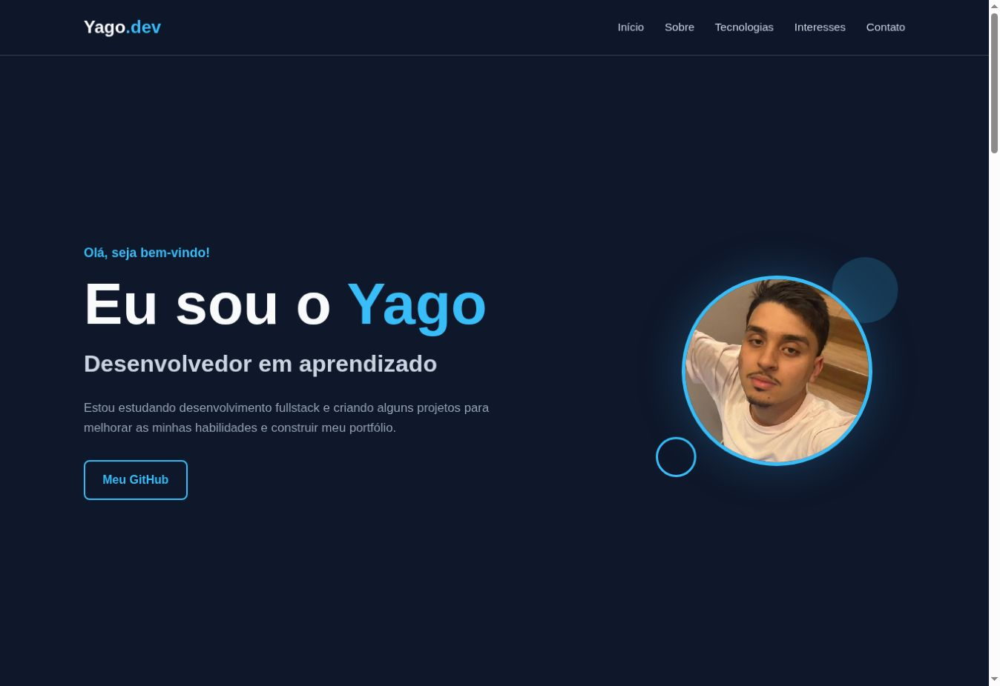

# Yago.dev | Portfólio pessoal

Minha apresentação como desenvolvedor em formação, reunindo tecnologias, interesses e formas de contato.

**[Abrir demonstração](https://yagog0.github.io/portfolio/)** · [Meu GitHub](https://github.com/Yagog0)



## O que você encontra
- Apresentação e seção sobre mim.
- Tecnologias que estudo e utilizo.
- Interesses pessoais.
- Links de contato e navegação adaptada a telas menores.

## Tecnologias
HTML, CSS e JavaScript, sem etapa de compilação.

## Executar localmente
```bash
git clone https://github.com/Yagog0/portfolio.git
cd portfolio
```

Abra `index.html` no navegador. Para servir por HTTP, se tiver Python instalado:

```bash
python -m http.server 8000
```

Acesse `http://localhost:8000`.

## Estrutura
| Caminho | Conteúdo |
| --- | --- |
| `index.html` | Página principal, estilos e interações |
| `imagens/` | Foto e imagens usadas nas seções |
| `Pagina Basica de apresentação/` | Material adicional de apresentação |

## Publicação
O site é publicado com GitHub Pages. Mantenha os caminhos das imagens relativos para funcionar tanto localmente quanto no site.

Desenvolvido por [Yago Maba](https://github.com/Yagog0).
